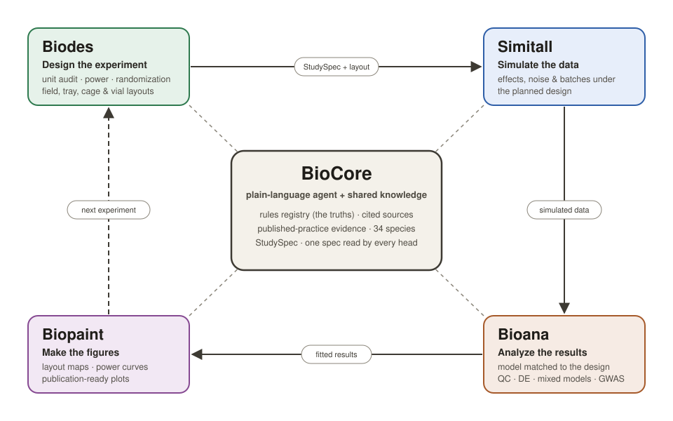
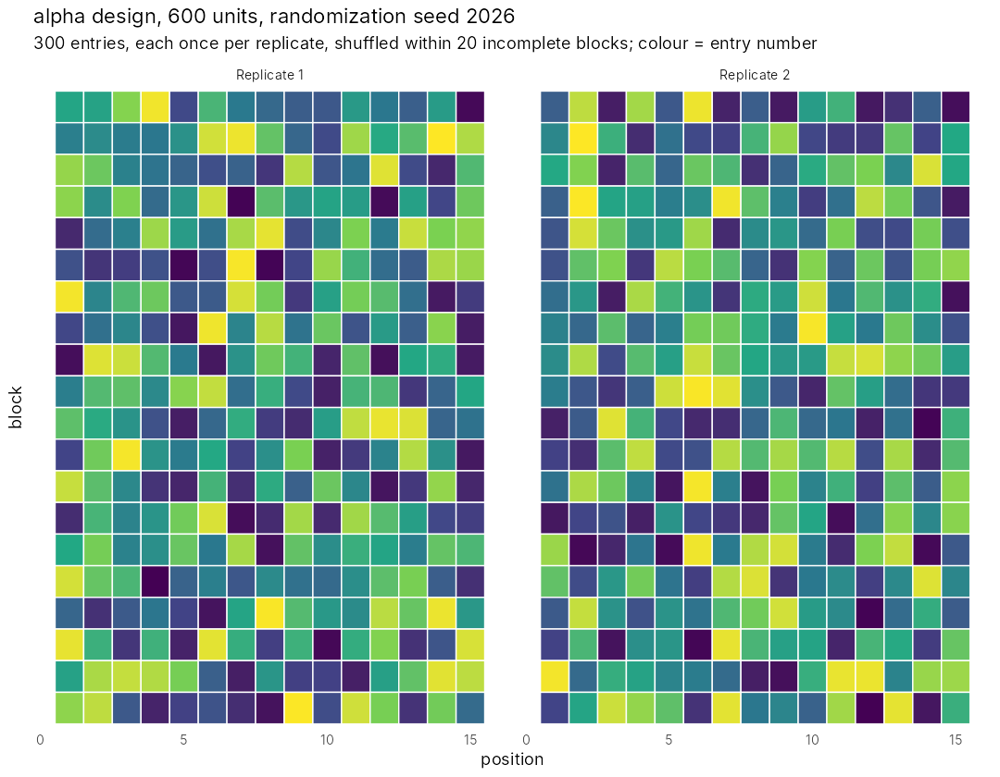

# Biodes

**Describe an experiment in plain English. Biodes asks the questions that change the design, then writes the
randomized layout, the sample sheet and the statistical model, before a single sample is collected.**

<p align="center">
  
</p>

Biodes is the first of four connected tools. **Biodes** designs the experiment, **[Simitall](https://github.com/nirwan1265/simitall)**
simulates data from that design with a known answer, **[Bioana](https://github.com/nirwan1265/Bioana)** analyzes it with the
model the design calls for and checks it recovered the answer, and **Biopaint** (in progress) draws the figures. They
pass one file between them, so the design, the simulation and the analysis can't disagree.

Free, offline, no API key. Every number (layouts, power, models) comes from deterministic R code; vocabulary and
decisions live in rule tables, not in a language model.

## One question, start to finish (real R output)

```r
> library(studyforge)

> # 1. Describe the experiment in plain English
> a <- studyforge_ask("RNA-seq of leaves from wild type and mutant Arabidopsis under drought and well-watered conditions, 4 plants per genotype per treatment; we want genes whose drought response differs between genotypes.")

> a
Biodes (local, free)

Here's what I understood (fix anything wrong: studyforge_fix(answer, organism = "...", factors = "name:levels")):
  Goal:                design a new study
  Organism:            Arabidopsis thaliana
  Setting:             ?
  Study type:          ?
  Assay / data:        rnaseq
  Method / resource:   ?
  Sequencing:          ? (typical: Illumina NovaSeq 6000, ~22.9 M reads per sample)
  Tissue:              leaf
  Factors (levels):    water (2); genotype (2)
  Outcome / phenotype: ?
  Experimental unit:   ?
  Replicates:          4
  Locations / seasons: ? / ?

Design facts: reps = 4

Still needed: system, primary_outcome.name, primary_outcome.type, experimental_unit, power.minimum_detectable_difference, power.residual_sd

Questions that change the design:
  - What is a biological replicate (plant, pool of plants, animal, culture)?
  - Conditions and time points; is sampling destructive?
  - Expected fold change of interest and sequencing depth?

Candidate designs:
  - Factorial treatment structure in RCBD: Interest in interactions (genotype x treatment, treatment x sex) and all combinations can be randomized at the same unit level. Tradeoff: Number of cells grows multiplicatively; interaction power needs larger n than main effects.
  - Randomized complete block design: All treatments fit in one reasonably homogeneous block (bench, field strip, batch, day). Tradeoff: Blocks become heterogeneous when they hold many entries (e.g., >20-30 field plots).
  - Completely randomized design: Units are homogeneous (e.g., one growth chamber shelf with no gradient); few units. Tradeoff: No control of spatial or batch heterogeneity; rarely the best choice in greenhouses or fields.

Published practice (what designed studies in ENA/SRA/GEO did; descriptive, not a recommendation):
  539 designed Bulk RNA-seq studies of Arabidopsis thaliana (leaf) in public archives (2012-2026).
  Replicates per condition: median 3 (IQR 2-3, from 313 studies); 11% used 6 or more.
  Read depth: median 22.9 M reads per run (IQR 18.1-29.6).
  Recent sequencers: Illumina NovaSeq 6000, Illumina HiSeq 2500, Illumina HiSeq 2000.
  Kits named in protocols: TRIzol, RNeasy Plant Mini, RNeasy Mini Kit, TruSeq Stranded Total RNA.
  Examples:
    PRJNA1087742 (2026; 4 reps; treatment[0.12% DMSO, spore solution (in 0.12% , spore solution with 10 µM]) doi:10.1016/j.plaphy.2025.109570
    PRJNA1222333 (2026; 5 reps; genotype[wildtype, snrk2.4/snrk2.10] x time[25 DAS, 45 DAS]) doi:10.1093/plphys/kiag502
    PRJNA1272414 (2026; 3 reps; line[C30-81-as6, Col-0]) doi:10.1007/s10265-026-01712-5
  For differential expression, 6 or more biological replicates detect far more genes than 3 (Schurch et al. 2016, doi:10.1261/rna.053959.115); base n on power, not on the median.

Starter code:
book <- layout_from_spec(a$spec, seed = 2026)   # randomized layout for this design
write_design_package(book, a$spec, "my_design")   # study_spec.json, field_layout.csv, sample sheet

Power: give a minimum detectable difference and residual SD (pilot data or literature); Biodes never assumes them. Then run power_rcbd(), power_split_plot() or power_alpha_lattice().

> # 2. Answer the questions Biodes asked
> a <- studyforge_fix(a, experimental_unit = "plant", primary_outcome.name = "gene expression")

> # 3. Randomized layout and the files the next tools read
> book <- layout_from_spec(a$spec, seed = 2026)

> book[1:8, c("plot", "block", "genotype", "water")]
  plot block  genotype        water
1  101     1 wild type well-watered
2  102     1    mutant well-watered
3  103     1 wild type      drought
4  104     1    mutant      drought
5  105     2 wild type      drought
6  106     2    mutant      drought
7  107     2    mutant well-watered
8  108     2 wild type well-watered

> write_design_package(book, a$spec, "rnaseq_design")
[1] "rnaseq_design/field_layout.csv"             "rnaseq_design/sample_metadata_template.tsv"
[3] "rnaseq_design/study_spec.json"             

> # 4. The design Biodes wrote
> spec <- jsonlite::fromJSON("rnaseq_design/study_spec.json")

> spec$design$chosen
[1] "factorial"

> spec$analysis$model
[1] "y ~ treatment * treatment2 + block"

> spec$analysis$primary_goal
[1] "interaction"

> spec$analysis$goal_terms$interaction
[1] "treatment"  "treatment2"
```

What happened:

1. **Biodes read the question**: organism, tissue, RNA-seq, two factors with their levels (*wild type / mutant*,
   *well-watered / drought*), 4 replicates, and the goal: *genes whose drought response differs between genotypes* is
   an **interaction**.
2. **It asked only what changes the design** (what a replicate is, time points, batches), showed the candidate
   designs, and what 539 published Arabidopsis leaf RNA-seq studies actually did.
3. **It wrote the files**: a randomized layout, a sample sheet, and `study_spec.json` with the model
   (`y ~ treatment * treatment2 + block`) and the goal (the treatment x treatment2 interaction), ready for Simitall and
   Bioana.

## Three worked examples

| Example | Design Biodes chose |
|---|---|
| [Sorghum GWAS, 300 accessions](examples/showcase/01_gwas_sorghum) | alpha lattice, 600 plots, mixed model |
| [RNA-seq, genotype x drought](examples/showcase/02_rnaseq_drought) | 2 x 2 factorial, interaction goal |
| [Seed priming, time to germination](examples/showcase/03_germination_survival) | survival design: censoring, seed rot as a competing event, 121 events needed |

<p align="center"></p>

## Install

```r
remotes::install_github("nirwan1265/BioDesignGPT")
library(studyforge)          # the package is still named studyforge while the rename to Biodes finishes
launch_studyforge()          # point-and-click app in your browser, on your own computer
```

## More

Everything else (how it was built and trained, the rules, the engines, accuracy, the suite contract) is in the
[full documentation](docs/README_DETAILED.md) and [docs/SUITE_INTEGRATION.md](docs/SUITE_INTEGRATION.md).
