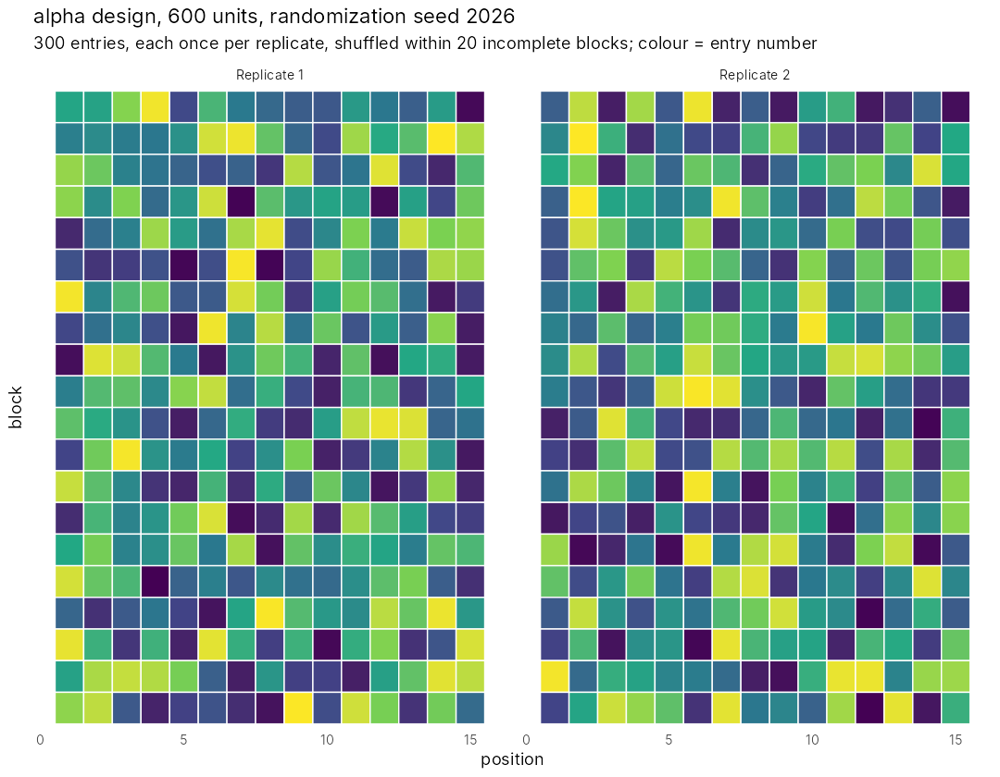

# GWAS of plant height in a sorghum diversity panel

**The question, as a researcher would type it:**

> GWAS of plant height in 300 sorghum accessions grown in an alpha lattice with 2 replicates at one location in one season.

**What Biodes asked back** (only questions that change the design):

- Plot size, seed per entry, maximum plots per location?
- Expected difference to detect and residual SD (pilot data or literature)?
- Where are irrigation laterals, mains or sprinkler lines, and which way does water flow?

Answer given here: plant height in cm; plot-to-plot SD about 15 cm from earlier trials.

## The design Biodes wrote

| | |
|---|---|
| Design | `alpha` |
| Units | 600 plots (one row each in the sample sheet) |
| Factors | `genotype` (300 levels) |
| Outcome | plant_height (continuous, cm) |
| Model | `y ~ treatment + rep + (1 \| rep:block)` |
| Goal | `association` |
| Power | no closed form for this goal: checked by simulation in Simitall (replicates as stated) |
| Randomization seed | 2026 |

**Defaults Biodes assumed (listed, never hidden):**

- `analysis.goal_effect.association.size`: not stated: use power.minimum_detectable_difference default

## Files

- [`study_spec.json`](study_spec.json): the full StudySpec that Simitall and Bioana read
- [`field_layout.csv`](field_layout.csv): the randomized layout, one row per unit
- [`sample_metadata_template.tsv`](sample_metadata_template.tsv): the sample sheet to fill in
- [`questions_asked.txt`](questions_asked.txt): what Biodes asked and the answers used

## Continue this example

- **Simitall** simulates data for this exact design: [simitall/examples/showcase/01_gwas_sorghum](https://github.com/nirwan1265/simitall/tree/main/examples/showcase/01_gwas_sorghum)
- **Bioana** analyzes it with the model above and checks the planted truth: [Bioana/examples/showcase/01_gwas_sorghum](https://github.com/nirwan1265/Bioana/tree/main/examples/showcase/01_gwas_sorghum)
- **Biopaint** draws the figures: Biopaint/examples/showcase/01_gwas_sorghum (in progress)

Rebuild this folder: `Rscript examples/showcase/make_showcase.R` (from the repository root).
