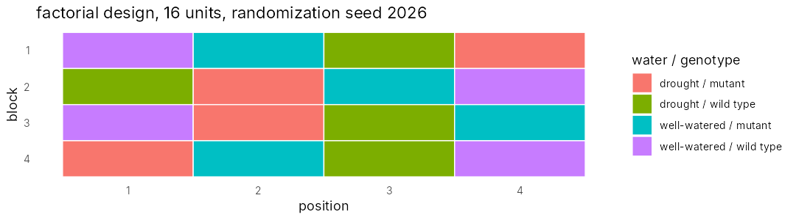

# RNA-seq: which genes respond to drought differently in a mutant

**The question, as a researcher would type it:**

> RNA-seq of leaves from wild type and mutant Arabidopsis under drought and well-watered conditions, 4 plants per genotype per treatment; we want genes whose drought response differs between genotypes.

**What Biodes asked back** (only questions that change the design):

- Conditions and time points; is sampling destructive?
- Expected fold change of interest and sequencing depth?
- Library prep and sequencing batches; can conditions be balanced across them?

Answer given here: one plant is one biological replicate.

## The design Biodes wrote

| | |
|---|---|
| Design | `factorial` |
| Units | 16 plants (one row each in the sample sheet) |
| Factors | `water` (well-watered, drought); `genotype` (wild type, mutant) |
| Outcome | gene counts per sample (RNA-seq) |
| Model | `y ~ treatment * treatment2 + block` |
| Goal | `interaction` on treatment x treatment2 |
| Power | no closed form for this goal: checked by simulation in Simitall (replicates as stated) |
| Randomization seed | 2026 |

**Defaults Biodes assumed (listed, never hidden):**

- `analysis.goal_effect.interaction.size`: not stated: use power.minimum_detectable_difference default

## Files

- [`study_spec.json`](study_spec.json): the full StudySpec that Simitall and Bioana read
- [`field_layout.csv`](field_layout.csv): the randomized layout, one row per unit
- [`sample_metadata_template.tsv`](sample_metadata_template.tsv): the sample sheet to fill in
- [`questions_asked.txt`](questions_asked.txt): what Biodes asked and the answers used

## Continue this example

- **Simitall** simulates data for this exact design: [simitall/examples/showcase/02_rnaseq_drought](https://github.com/nirwan1265/simitall/tree/main/examples/showcase/02_rnaseq_drought)
- **Bioana** analyzes it with the model above and checks the planted truth: [Bioana/examples/showcase/02_rnaseq_drought](https://github.com/nirwan1265/Bioana/tree/main/examples/showcase/02_rnaseq_drought)
- **Biopaint** draws the figures: Biopaint/examples/showcase/02_rnaseq_drought (in progress)

Rebuild this folder: `Rscript examples/showcase/make_showcase.R` (from the repository root).
