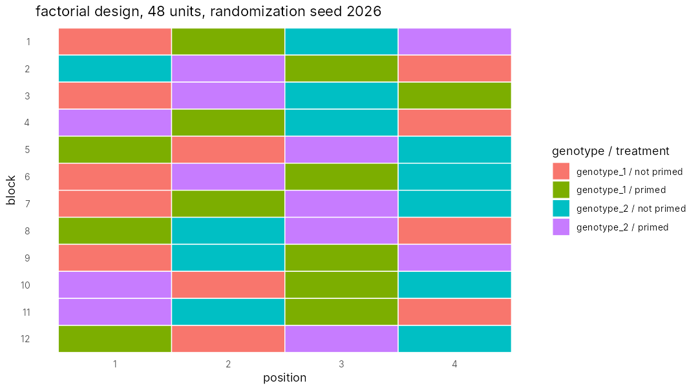

# Seed priming and time to germination (survival design)

**The question, as a researcher would type it:**

> Seeds of 2 sorghum lines primed or not in 12 trays in a growth chamber, 10 seeds per treatment per tray, days to germination checked every 2 days, followed for 21 days; seed rot can occur before germination; the priming effect is delayed; hazard ratio 0.6; germination by day 7 and 14.

**What Biodes asked back** (only questions that change the design):

- How many chambers, and is the treatment a chamber setting (temperature, CO2, photoperiod)?
- Can runs be repeated with treatments swapped between chambers?
- Shelf/position effects inside each chamber?

Answer given here: none needed for the design: one chamber, no repeated runs, trays are the blocks.

## The design Biodes wrote

| | |
|---|---|
| Design | `factorial` |
| Units | 48 tray cells (480 seeds, one row each in the sample sheet) |
| Factors | `genotype` (2 levels); `treatment` (not primed, primed) |
| Outcome | germination (survival, days) |
| Model | `y ~ treatment * treatment2 + (1 \| block)` |
| Goal | `survival` |
| Power | Schoenfeld: hazard ratio 0.6 needs **121 events** (alpha 0.05, power 0.8) |
| Survival analysis | share germinated at days 7 and 14; weighted log-rank `fh_0_1` (stated delayed effect); life table in 2-day intervals; seeds clustered in `plot` |
| Event codes | 0 = censored, 1 = germination, 2 = seed rot before germination |
| Censoring | administrative at 21 days (end of follow-up) |
| Randomization seed | 2026 |

**Defaults Biodes assumed (listed, never hidden):**

- `factors.time`: removed: time is the outcome of a survival study; stated times are landmarks

## Files

- [`study_spec.json`](study_spec.json): the full StudySpec that Simitall and Bioana read
- [`field_layout.csv`](field_layout.csv): the randomized layout, one row per unit
- [`sample_metadata_template.tsv`](sample_metadata_template.tsv): the sample sheet to fill in
- [`questions_asked.txt`](questions_asked.txt): what Biodes asked and the answers used

## Continue this example

- **Simitall** simulates data for this exact design: [simitall/examples/showcase/03_germination_survival](https://github.com/nirwan1265/simitall/tree/main/examples/showcase/03_germination_survival)
- **Bioana** analyzes it with the model above and checks the planted truth: [Bioana/examples/showcase/03_germination_survival](https://github.com/nirwan1265/Bioana/tree/main/examples/showcase/03_germination_survival)
- **Biopaint** draws the figures: Biopaint/examples/showcase/03_germination_survival (in progress)

Rebuild this folder: `Rscript examples/showcase/make_showcase.R` (from the repository root).
